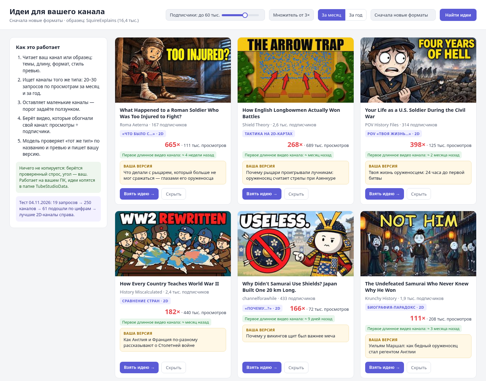

# Идеи для канала: новые форматы, которые обгоняют свой канал

| Порядок | Этап | Вид | Выпуск | Статус |
| --- | --- | --- | --- | --- |
| 45 | Темы и идеи | Правило | 1 · Темы и сценарий | Предложено |

**В TubeStudio:** Экран «Идеи для канала»: маленькие каналы того же типа, видео-выбросы, «ваша версия», кнопка «Взять идею →»

[Открыть в Notion](https://app.notion.com/p/81a362191a2041ebb278d536f73349af)

---

> ✅ Ответ на ваш скриншот: да, такой экран делаем. Это Радар из Выпуска 1. На нём же пройдёт главный тест выпуска: Радар должен сам найти каналы вроде Neurognite и PsychExp.

*Макет экрана на реальных данных теста от 04.11.2026. «Ваша версия» написана для примера под канал в стиле SquireExplains.*
### Как это работает
1. **Читает ваш канал или канал-образец** (например, SquireExplains): темы, длину роликов, формат, стиль превью. Получается «отпечаток формата».
2. **Ищет каналы того же типа:** 20–30 поисковых запросов по вашим темам и по названиям роликов образца, сортировка «по просмотрам» за месяц и за год, плюс «похожие каналы».
3. **Оставляет маленькие каналы.** Порог задаётся ползунком, по умолчанию до 60 тыс. подписчиков. Жёсткий порог 15 тыс., как на скриншоте, отсёк бы даже ваш образец: у SquireExplains 16,4 тыс.
4. **Берёт видео, которые обогнали свой канал:** множитель «просмотры ÷ подписчики» от 3× и сравнение с медианой самого канала.
5. **Проверяет «тот же тип».** Дешёвая модель смотрит названия и превью и убирает чужое. В тесте по цифрам проходили реакции на фильмы, музыка и игры, так что без этой проверки нельзя.
6. **Сначала новые форматы:** сортировка по дате первого длинного видео канала. Если канал начал длинные ролики месяц назад и уже собрал сотни тысяч просмотров, формат свежий и рабочий.
7. **Пишет «вашу версию»:** свой угол под ваш канал. Названия, сюжеты и картинки не копируются.
8. **«Взять идею →»** создаёт проект ролика: идея, ссылка на образец, ваша версия. Дальше обычный путь: оценка идеи, исследование, сценарий.
### Что на карточке идеи
Превью · название · канал и подписчики · формат в 2–4 словах · множитель и просмотры · «первое длинное видео канала» · ваша версия · кнопки «Взять идею →» и «Скрыть».
### Где хранится и сколько стоит
- Работает на вашем ПК. Найденное копится в папке TubeStudioData: каждый новый поиск дополняет базу, скрытые идеи больше не показываются.
- Поиск идёт через бесплатный ключ YouTube Data API. Дневная квота 10 000 единиц, один поиск стоит 100, то есть до 100 поисков в день. Обычный прогон Радара — 20–30 поисков.
- Новые видео найденных каналов TubeStudio отслеживает через RSS-ленты YouTube: бесплатно и без расхода квоты.
- «Ваша версия» и проверка типа — дешёвая модель, центы за прогон.
### Тест 04.11.2026 (прототип)
19 запросов про военную историю → 250 каналов → 61 подошёл по цифрам (до 60 тыс. подписчиков, длинное видео от 30 тыс. просмотров, множитель от 3×) → после проверки превью около дюжины 2D-каналов того же типа, что SquireExplains. Лучшие:
<table header-row="true">
<tr>
<td>Канал</td>
<td>Подписчики</td>
<td>Видео</td>
<td>Просмотры</td>
<td>Множитель</td>
<td>Длинные видео с</td>
</tr>
<tr>
<td>Roma Aeterna</td>
<td>167</td>
<td>[What Happened to a Roman Soldier Who Was Too Injured to Fight?](https://youtu.be/AmHirSfkqZ8)</td>
<td>111 тыс.</td>
<td>665×</td>
<td>≈ 4 недели назад</td>
</tr>
<tr>
<td>POV History Files</td>
<td>314</td>
<td>[Your Life as a U.S. Soldier During the Civil War](https://youtu.be/xRA8pq_Eln0)</td>
<td>125 тыс.</td>
<td>398×</td>
<td>≈ 2 месяца назад</td>
</tr>
<tr>
<td>Shield Theory</td>
<td>2,6 тыс.</td>
<td>[How English Longbowmen Actually Won Battles](https://youtu.be/-dbq6e8-a8A)</td>
<td>689 тыс.</td>
<td>268×</td>
<td>≈ месяц назад</td>
</tr>
<tr>
<td>History Miscalculated</td>
<td>2,4 тыс.</td>
<td>[How Every Country Teaches World War II](https://youtu.be/9B528xQfDHY)</td>
<td>440 тыс.</td>
<td>182×</td>
<td>≈ месяц назад</td>
</tr>
<tr>
<td>channelforawhile</td>
<td>433</td>
<td>[Why Didn't Samurai Use Shields? Japan Built One 20 km Long.](https://youtu.be/442s77ogB1A)</td>
<td>72 тыс.</td>
<td>166×</td>
<td>≈ 9 дней назад</td>
</tr>
<tr>
<td>Krunchy History</td>
<td>1,9 тыс.</td>
<td>[The Undefeated Samurai Who Never Knew Why He Won](https://youtu.be/BEP58jgCRMc)</td>
<td>208 тыс.</td>
<td>111×</td>
<td>≈ 3 месяца назад</td>
</tr>
</table>
### Уроки теста
- Обычный поиск «по релевантности» выдаёт крупные каналы: 89 из 90 найденных были больше 50 тыс. подписчиков. Нужна сортировка по просмотрам за месяц и за год.
- Цифры без проверки типа пропускают чужое: реакции на фильмы, музыку, игры.
- Сам SquireExplains по этим запросам не нашёлся. Поэтому Радар ищет ещё и по названиям роликов образца, и через «похожие каналы».
- Даты YouTube отдаёт приблизительно («месяц назад»), поэтому «первое длинное видео» — с точностью до недели.
### Связь с другими карточками
Дополняет карточку [Где искать темы со спросом](../cards/040.md): там правило «выбросы от 3× медианы канала», здесь экран, который находит такие видео у маленьких каналов. Разбор образца — в карточке [Профиль канала и бренд-кит](../cards/020.md).
